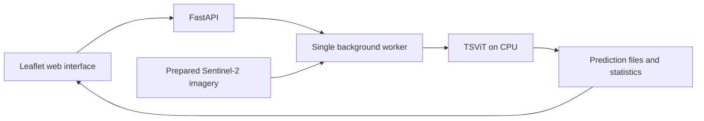

# Crop Mapping

Crop Mapping classifies crops from prepared Sentinel-2 satellite time series using a trained TSViT model. Users select an area and season on a Leaflet map, run an analysis, and download the resulting crop map and area statistics. FastAPI serves both the API and the web interface.

The project provides CPU inference, Docker Compose deployment, and GitHub Actions workflows for testing, image publishing, and deployment to an existing AWS EC2 instance. Training is outside this application's scope.

- **Source:** https://github.com/loanhviet/crop-mapping
- **Public image:** https://hub.docker.com/r/loanhviet070105/crop-mapping
- **Maintainer:** [Lỗ Anh Việt (@loanhviet)](https://github.com/loanhviet)

## 1. System Overview



The browser sends a GeoJSON polygon and season to FastAPI. A single background worker reads the relevant imagery, applies the checkpoint-compatible preprocessing, runs TSViT, and writes results. The browser polls job status and displays the completed classification overlay. Each accepted analysis request runs a fresh prediction.

The application and checkpoint are packaged in the **release image**. Satellite imagery stays outside the image and is mounted read-only; generated results are stored in a persistent Docker volume. No database or frontend build service is required.

| Location | Responsibility |
| --- | --- |
| `app.py` | HTTP endpoints, application startup, job queue, and frontend serving |
| `inference.py`, `model.py` | Model loading, preprocessing, TSViT, and geospatial exports |
| `imagery.py`, `cog_data.py`, `predictions.py` | Imagery acquisition/preparation support and prediction storage |
| `web/` | HTML, CSS, JavaScript, Leaflet, and licensed frontend assets |
| `prepare_data.py`, `prepare_cog.py`, `prepare_regions.py`, `preparation/` | Dataset preparation tools, configurations, and notebooks |
| `weights/`, `assets/model-manifest.json` | Model configuration, license, and checkpoint integrity metadata |
| `scripts/` | Asset verification, release builds, smoke tests, and validation tools |
| `tests/`, `conftest.py`, `pytest.ini` | Regression tests and external-asset test gates |
| `Dockerfile`, `compose.yaml`, `compose.production.yaml` | Development and release container configurations |
| `.github/workflows/`, `deployment/` | CI, publishing, and digest-based EC2 deployment |
| `docs/` | Detailed setup, model/data, testing, and deployment documentation |

## 2. Environment

The commands below target **Linux AMD64 or an AMD64 Ubuntu environment in WSL2**, using a Bash-compatible shell. Container execution has been verified on Ubuntu 24.04 AMD64. Native Windows, macOS, ARM64, and GPU execution are not validated by this guide.

| Requirement | Version or condition |
| --- | --- |
| Python | 3.13 for local development; the image pins Python 3.13.18 on Debian Bookworm |
| Main dependencies | PyTorch `2.14.1+cpu`, FastAPI `0.143.0`, NumPy `2.5.4`, Rasterio `1.5.2` |
| Dependency files | `requirements.txt` for direct versions; `requirements/locks/linux-amd64.txt` for hash-locked runtime installation |
| Containers | Docker Engine, Docker Compose v2, and Buildx for image builds |
| Hardware | CPU inference; GPU is not required. Compose defaults to 2 CPUs and a 2 GiB memory limit; larger analyses may need more resources. |
| External assets | A matching checkpoint for native/development runs and compatible prepared imagery for every deployment |
| Storage | Space for the image, datasets, and accumulating results. The nine-block Normandy dataset alone occupies approximately 8.28 GB. |
| Network | Required to install dependencies, prepare/download imagery, pull images, and display external basemap tiles |

Local setup uses binary wheels, including Rasterio's bundled GDAL. There is no Node.js installation or separate frontend build step.

## 3. Setup

Run the following commands from the repository root unless stated otherwise. These steps prepare the native development environment and a small PASTIS dataset. To run a published image with an already prepared dataset, go to [Docker Compose](#8-docker-and-docker-compose); the release image already contains Python, dependencies, and the checkpoint.

### 3.1. Clone the repository

```bash
git clone https://github.com/loanhviet/crop-mapping.git
cd crop-mapping
```

**Expected:** the directory contains `app.py`, `Dockerfile`, `compose.production.yaml`, and `assets/model-manifest.json`.

### 3.2. Install the development environment

```bash
python3.13 -m venv .venv
.venv/bin/python -m pip install --only-binary=:all: --require-hashes \
  -r requirements/locks/linux-amd64.txt
.venv/bin/python -m pip install pytest==9.1.1
.venv/bin/python -m pip check
cp .env.example .env
```

**Expected:** `pip check` reports `No broken requirements found.` The virtual environment is used explicitly in subsequent commands; activating it is optional.

The runtime lock is specific to Linux AMD64 and Python 3.13. Keep real credentials in local configuration or GitHub Secrets, never in Git.

### 3.3. Provision the checkpoint

Git excludes `weights/best.pth`. Obtain the exact artifact from the maintainer or an authorized artifact source and place it at that path. Keep the tracked `weights/config.yaml` alongside it. No anonymous checkpoint download URL is supplied.

```bash
.venv/bin/python scripts/verify_assets.py --profile model
```

**Expected:** `Asset integrity checks passed. Model loading and inference were not executed.` A missing or mismatched file must be resolved before starting the application; see [AI Model](#6-ai-model).

### 3.4. Prepare the demo imagery

This command downloads the selected patches from the official PASTIS archive and writes local data. It requires upstream availability and network access.

```bash
.venv/bin/python prepare_data.py --patches 10000 10003
.venv/bin/python scripts/verify_assets.py --profile ci
```

**Expected:** asset verification passes and these files exist:

```text
data/
├── catalog.json
├── metadata.geojson
├── S2_10000.npy
└── S2_10003.npy
```

Patch `10003` is available for the demo; patch `10000` supports regression fixtures and is not advertised as a public test region. Preserve the downloaded metadata, band order, dates, and catalog together. Arbitrary satellite files are not a replacement for this prepared layout.

For continuous Normandy imagery, use the separately documented [COG preparation](docs/COG.md) and [multi-block regions](docs/REGIONS.md). Full provisioning requirements are in [ASSETS.md](docs/ASSETS.md).

## 4. Run and Verify

### 4.1. Start the application

Keep this terminal running:

```bash
CROP_SOURCE=prepared CROP_DEVICE=cpu CROP_THREADS=2 \
  CROP_DATA_DIR="$PWD/data" CROP_WEIGHTS_DIR="$PWD/weights" \
  CROP_RESULTS_DIR="$PWD/data/results" \
  .venv/bin/python -m uvicorn app:app \
    --host 127.0.0.1 --port 8000 --workers 1
```

**Expected:** Uvicorn reports application startup complete and listens on `http://127.0.0.1:8000`. Open that address in a browser. Keep a single Uvicorn worker because the job queue is maintained in application memory.

### 4.2. Check startup and model identity

In another terminal:

```bash
curl --fail http://127.0.0.1:8000/api/health
curl --fail http://127.0.0.1:8000/api/catalog
```

**Expected health fields** (the actual response contains additional fields):

```json
{
  "status": "ok",
  "model": "TSViT",
  "device": "cpu",
  "checkpoint_sha256": "92a83d0d94e529e762233c571efdcf36513cf503b678fc9dba09b8171a40b733"
}
```

The catalog should contain available patches and season `2018–2019`. A healthy response confirms application/model startup; it does not run a satellite prediction.

### 4.3. Check real inference and exports

With the demo server still running, use a new output directory for each smoke test:

```bash
.venv/bin/python scripts/container_smoke.py \
  --url http://127.0.0.1:8000 --patch-id 10003 \
  --output .validation/demo-smoke --timeout 180
```

**Expected:** the JSON summary reports `"status": "passed"`, the expected checkpoint hash, positive pixel/area counts, and exports `tif`, `csv`, `png`, `geojson`, `zip`. The script submits two small analyses to verify fresh inference on repeated requests and saves the summary and exports in `.validation/demo-smoke/`. It refuses an unexpectedly large AOI.

This is a functional check, not an accuracy benchmark. Use a different `--output` directory if it already exists.

## 5. Configuration

Copy `.env.example` to `.env` and adjust values for the chosen run mode. **Compose reads `.env` for interpolation; native Python path/device settings must be exported in the shell before starting Uvicorn.** The native command above sets them explicitly.

| Variable | Purpose and scope |
| --- | --- |
| `CROP_SOURCE` | Native imagery mode; the documented path uses `prepared`. Both Compose configurations fix this mode. |
| `CROP_DEVICE` | Native device; production Compose defaults to `cpu`. Development Compose fixes CPU. |
| `CROP_THREADS` | PyTorch CPU threads; passed into both Compose services. |
| `CROP_DATA_DIR` | Native data directory; in production Compose, the **host-side** imagery path mounted at `/app/data`. Development Compose always binds `./data`. |
| `CROP_WEIGHTS_DIR` | Native weights directory. Development Compose binds `./weights` at `/app/weights`; production uses packaged weights. |
| `CROP_RESULTS_DIR` | Native results directory. Containers use `/app/results` in a named volume. |
| `CROP_BIND`, `CROP_PORT` | Compose host address/port; defaults are `127.0.0.1:8000`. Native Uvicorn uses its CLI flags. |
| `CROP_IMAGE` | Production image reference. Replace the template's `unpublished` value with a verified tag or digest. |
| `CROP_CPUS`, `CROP_MEMORY_LIMIT` | Production container limits; defaults are 2 CPUs and `2g`. |
| `CROP_RESULTS_VOLUME` | Production results-volume name; default `crop-mapping-results`. Preserve the existing name during updates. |

Prepared/offline imagery does not require `GEODES_API_KEY`. The optional GEODES acquisition mode has separate credentials and download limits; see [GEODES.md](docs/GEODES.md). Do not enable it just to run the prepared demo.

## 6. AI Model

| Item | Implementation |
| --- | --- |
| Model | TSViT, architecture in `model.py`, configuration in `weights/config.yaml` |
| Checkpoint identity | `best.pth`, 6,665,903 bytes; SHA256 recorded in `assets/model-manifest.json` and the health example above |
| Input | Prepared Sentinel-2 reflectance time series with ten bands and one day-of-year value per observation |
| Band order | `B2`, `B3`, `B4`, `B5`, `B6`, `B7`, `B8`, `B8A`, `B11`, `B12` |
| Preprocessing | Fixed training mean/std, 24 × 24 pixel windows, at most 60 observations, temporal padding, and a normalized day-of-year channel |
| Output | 19 class labels (`0–18`), per-pixel model confidence, class areas, and geospatial exports; nodata is `255` |
| Runtime | Evaluation mode, strict checkpoint loading, PyTorch CPU inference |

The release Dockerfile verifies checkpoint/config hashes during the build. Native startup loads the supplied checkpoint; run the asset verifier first to establish its identity against the manifest. Never substitute unrelated weights or reorder bands to make a run pass.

Confidence is an uncalibrated model probability. Successful inference does not establish classification accuracy against field observations. The current prepared catalog uses season `2018–2019`. This application is independent of the TSViT + DINOv3 research project.

## 7. Usage and API

### Web interface

1. Open `http://127.0.0.1:8000` and choose an available region and season.
2. Draw a small area inside the imagery footprint and inspect the imagery plan.
3. Start analysis and wait for completion; progress and cancellation are available.
4. Inspect the crop overlay, pixel class/confidence, and class areas. Download GeoTIFF, CSV, PNG, GeoJSON, or ZIP.

The ZIP contains classification files, area statistics, and result metadata. Completed results survive a container replacement when the same results volume is retained.

### API endpoints

Interactive API documentation is at `http://127.0.0.1:8000/docs`; the schema is at `/openapi.json`. A [Postman collection and example requests](docs/postman/README.md) are also included.

| Method | Endpoint | Purpose |
| --- | --- | --- |
| GET | `/api/health` | Application, device, and checkpoint identity |
| GET | `/api/catalog` | Available regions, seasons, and classes |
| POST | `/api/imagery-plan` | Validate the AOI and describe required imagery/windows |
| POST | `/api/analyses` | Submit an analysis; HTTP 202 with `id` and `cached: false` |
| GET / DELETE | `/api/analyses/{id}` | Poll job status / request cancellation |
| GET | `/api/analyses/{id}/overlay.png` | Completed classification overlay |
| GET | `/api/analyses/{id}/pixel?lat=...&lng=...` | Query a completed prediction pixel |
| GET | `/api/analyses/{id}/download/{format}` | Download `tif`, `csv`, `png`, `geojson`, or `zip` |

An analysis request contains `patch_id`, `season`, and `geometry`: a closed WGS84 GeoJSON `Polygon` with one ring inside the selected footprint. Use a region and season returned by your own catalog. Job states include `queued`, `running`, `done`, `error`, and `cancelled`; download results after `done`. The smoke command in section 4 exercises this request/poll/download flow against the demo assets.

## 8. Docker and Docker Compose

### 8.1. Run the published release image

Prepare the compatible imagery directory first. The image includes the verified checkpoint; **do not bind a host weights directory over `/app/weights`**.

From the cloned repository, create `.env` from `.env.example` if needed. The following shell variables select a previously verified public AMD64 release and the host imagery directory:

```bash
export CROP_IMAGE='loanhviet070105/crop-mapping@sha256:6af919d905afe0696d2c92b7bc8ad66f696ca4b143d25182ecb9ebf7c9ca727e'
export CROP_DATA_DIR="$PWD/data"
export CROP_BIND=127.0.0.1
export CROP_PORT=8000

docker compose --env-file .env -f compose.production.yaml config --quiet
docker compose --env-file .env -f compose.production.yaml pull
docker compose --env-file .env -f compose.production.yaml up -d --no-build --wait
docker compose --env-file .env -f compose.production.yaml ps
curl --fail http://127.0.0.1:8000/api/health
```

**Expected:** configuration validation exits successfully, the `crop-map` service becomes `healthy`, and health reports the checkpoint shown in section 4. The Compose project name is `crop-mapping-production`. Run the smoke test with a patch ID installed in that deployment to verify real inference.

Shell variables override `.env` for these commands. For later terminal sessions, put the selected image and host paths in your private `.env` file. The imagery bind source must already exist and be readable by container UID `10001`; Compose is configured not to create missing host directories silently.

Production runs non-root with a read-only root filesystem, dropped capabilities, read-only imagery, a temporary `/tmp`, and persistent results at `/app/results`. Keep the application on localhost unless a separately reviewed access configuration is in place. On hosts where Docker needs elevated access, use the configured `sudo -n docker` command consistently.

Do not use `docker compose down -v` when results must survive. Do not share a results volume between concurrently running application instances.

### 8.2. Build locally

The default Docker target is `development`: it excludes the checkpoint and relies on host weights/data mounts.

```bash
docker compose config --quiet
docker compose up -d --build --wait
docker compose ps
```

**Expected:** the development service starts using `./data`, `./weights`, and its own named results volume. Stop any other service using port 8000 first, or select another `CROP_PORT`.

For a release image, use a **clean Git checkout** and the existing build helper:

```bash
CROP_CHECKPOINT_FILE="$PWD/weights/best.pth" scripts/build_image.sh amd64
```

**Expected:** a local `loanhviet070105/crop-mapping:sha-<12-character-commit>-amd64` image is built and loaded. The helper checks the checkpoint, supplies only `best.pth` through a separate named build context, and never publishes. A dirty working tree is rejected to avoid assigning a commit tag to uncommitted source. Datasets, results, `.env`, and credentials remain outside the build context/image.

See [CONTAINERS.md](docs/CONTAINERS.md) for image inspection and release provisioning details. These builds currently support only `linux/amd64`.

## 9. Tests and CI/CD

### Regression tests

From the native environment in section 3:

```bash
# CI profile: no external checkpoint or satellite fixtures needed.
.venv/bin/python -m pytest -q -rs -m 'not external_assets'

# Full suite: provision the model and PASTIS fixtures first.
.venv/bin/python scripts/verify_assets.py --profile ci
.venv/bin/python -m pytest -q -rs --require-assets
```

**Expected:** selected tests pass. `--require-assets` fails collection when required assets are missing rather than silently skipping those tests. The lightweight profile does not prove real inference; the full suite and HTTP smoke test exercise it with provisioned assets. See [TESTING.md](docs/TESTING.md).

### GitHub Actions

| Workflow | Trigger | Automated checks/actions |
| --- | --- | --- |
| `ci.yml` | Push, pull request, or reusable workflow call | Lightweight pytest, both Compose configurations, Dockerfile build checks |
| `publish.yml` | Manual dispatch on `main` | CI gate, private checkpoint download, SHA256/config verification, AMD64 release build, CPU model initialization, Docker Hub push and registry digest comparison |
| `deploy.yml` | Manual dispatch on `main`, using the `production` environment | Verify source/tag/digest, SSH to the existing EC2 host, Compose update, health/checkpoint verification, and attempted rollback on deployment failure |

Publishing uses `DOCKERHUB_USERNAME`, `DOCKERHUB_TOKEN`, and read-only access to the private GitHub Release checkpoint asset. Tags use `sha-<full-commit>-amd64`; deployment uses an exact `@sha256:...` reference. The workflows reject existing release tags, while registry-side immutability must be managed separately.

CI, publishing, and an actual change to a new image digest have succeeded: [PR #6](https://github.com/loanhviet/crop-mapping/pull/6), [publish run](https://github.com/loanhviet/crop-mapping/actions/runs/41193793743), and [CD run](https://github.com/loanhviet/crop-mapping/actions/runs/41193983425). Real EC2 inference before and after that metadata-only release completed with 36 valid pixels, 0.36 ha, and all five export formats; this is a recorded functional result, not an accuracy claim or a live uptime guarantee.

EC2, Docker, imagery, Secrets, and initial SSH access are provisioned manually. CD requires manually allowing the current GitHub runner's SSH source `/32` and removing that temporary rule afterward. Publish verifies model initialization; CD verifies health/model identity. Neither workflow currently performs the real satellite HTTP smoke test automatically. Rollback is covered by simulated tests and has not been exercised on EC2.

See [CI.md](docs/CI.md) for artifact access and registry setup, [CD.md](docs/CD.md) for deployment requirements and recovery, and [BRANCHING.md](docs/BRANCHING.md) for the contribution workflow. Some detailed guides retain historical phase-specific validation notes; the successful runs above identify the verified release.

## 10. Troubleshooting and Limitations

| Symptom | What to check |
| --- | --- |
| `ModuleNotFoundError` or an unavailable wheel | Use the `.venv/bin/python` environment and Python 3.13 on Linux AMD64; install the runtime lock and run `pip check`. |
| Missing checkpoint or integrity mismatch | Place the trusted artifact at `weights/best.pth`, retain matching config, and rerun `scripts/verify_assets.py --profile model`. Release containers should not need host weights. |
| `No prepared imagery installed` / empty catalog | Prepare imagery and inspect the catalog and referenced files. A model image alone cannot provide satellite data. |
| Bind source does not exist / permission denied | Check the host-side `CROP_DATA_DIR`, directory traversal/read permissions for UID 10001, and the Compose resolved configuration. Do not make everything world-writable. |
| Port 8000 is already in use | Stop the other local instance or choose another Compose `CROP_PORT`; native Uvicorn uses `--port`. |
| HTTP 422 when planning/submitting | Choose the catalog's season and a valid closed polygon inside available imagery, containing at least one 10 m pixel center. |
| HTTP 429 or slow analysis | There is one worker and at most four pending/running jobs. Wait for completion and select a smaller AOI. Inspect native logs or `docker compose -f compose.production.yaml logs --tail 100 crop-map`. |
| Basemap is blank | Check browser Internet access to external tile services. Prepared imagery and model inference do not supply basemap tiles. |
| Smoke output directory already exists | Choose a new `--output` directory; the smoke script intentionally refuses to overwrite evidence. |
| Release helper rejects a dirty checkout | Review and commit approved source changes before creating a commit-derived release tag. |

Large AOIs can exceed available time or memory; whole-region analysis currently has no prepared-window cap. Cancellation is cooperative and may wait for the current model forward pass or export. The application has no login, rate limiting, HTTPS termination, or automatic results-retention policy. It is configured for localhost access; remote access can use an SSH tunnel as described in [CD.md](docs/CD.md).

Keep the [TSViT license](weights/LICENSE.txt), [Leaflet license](web/assets/LEAFLET-LICENSE.txt), [font license](web/assets/CARLITO-LICENSE.txt), and [third-party notices](THIRD_PARTY_NOTICES.md). There is no project-wide application license file; third-party notices do not automatically license all application code or grant redistribution rights to every checkpoint/dataset. Check asset permissions before redistributing artifacts.
