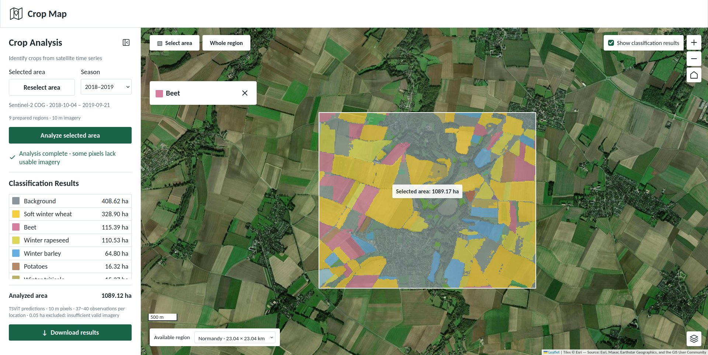
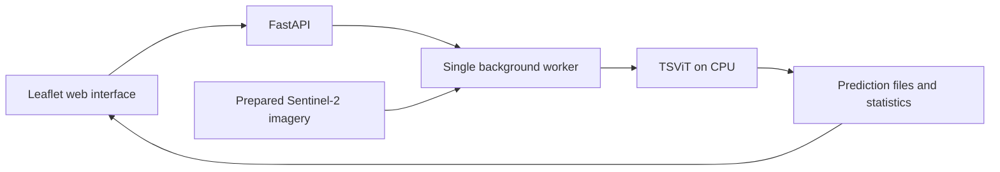
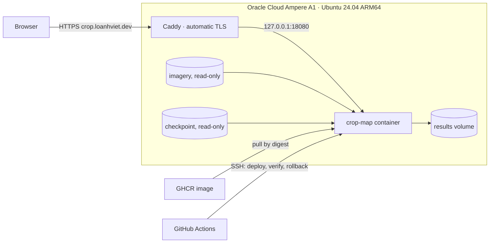
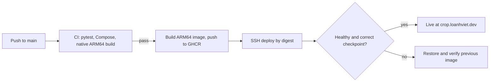

# Crop Mapping

[](https://github.com/loanhviet/crop-mapping/actions/workflows/cd.yml)

Crop Mapping classifies crops from prepared Sentinel-2 satellite time series using a trained TSViT model. Users select an area and season on a Leaflet map, run an analysis, and download the resulting crop map and area statistics. FastAPI serves both the API and the web interface.

The project provides CPU inference, Docker Compose operation, and a GitHub Actions CI/CD pipeline that automatically deploys every change on `main` to an Oracle Cloud ARM64 server, with health checks and automatic rollback. Training is outside this application's scope.

- **Live demo:** https://crop.loanhviet.dev
- **API documentation (Swagger UI):** https://crop.loanhviet.dev/docs
- **Source:** https://github.com/loanhviet/crop-mapping
- **Container image:** [`ghcr.io/loanhviet/crop-mapping`](https://github.com/loanhviet/crop-mapping/pkgs/container/crop-mapping)
- **Maintainer:** [Lỗ Anh Việt (@loanhviet)](https://github.com/loanhviet)



## 1. System Overview



The browser sends a GeoJSON polygon and season to FastAPI, which queues the job and returns immediately (HTTP 202). A single background worker reads the relevant imagery, applies the checkpoint-compatible preprocessing, runs TSViT on 24 × 24 pixel windows, and writes results. The browser polls job status and displays the completed classification overlay. Each accepted analysis request runs a fresh prediction.

The container image contains the application and its dependencies only. The checkpoint and satellite imagery are mounted read-only from the host, and generated results are stored in a persistent Docker volume. No database or frontend build service is required.

| Location | Responsibility |
| --- | --- |
| `app.py` | HTTP endpoints, application startup, job queue, and frontend serving |
| `inference.py`, `model.py` | Model loading and integrity check, preprocessing, TSViT, and geospatial exports |
| `imagery.py`, `cog_data.py`, `predictions.py` | Imagery acquisition/preparation support and prediction storage |
| `web/` | HTML, CSS, JavaScript, Leaflet, and licensed frontend assets |
| `prepare_data.py`, `prepare_cog.py`, `prepare_regions.py`, `preparation/` | Dataset preparation tools, configurations, and notebooks |
| `weights/`, `assets/model-manifest.json` | Model configuration, license, and checkpoint integrity metadata |
| `scripts/` | Asset verification, image builds, smoke tests, and validation tools |
| `tests/`, `conftest.py`, `pytest.ini` | Regression tests and external-asset test gates |
| `Dockerfile`, `compose.yaml`, `compose.production.yaml`, `compose.oracle.yaml` | AMD64/ARM64 image build; development, production, and Oracle Compose configurations |
| `.github/workflows/`, `deployment/` | CI, and CD to Oracle (GHCR image, SSH deployment script with health check and rollback) |
| `docs/` | Detailed setup, model/data, testing, and deployment documentation |

## 2. Environment

The native development commands below target **Linux AMD64 or an AMD64 Ubuntu environment in WSL2**, using a Bash-compatible shell. The container image runs on both `linux/amd64` and `linux/arm64`; production runs on an Oracle Cloud Ampere A1 VM (ARM64, Ubuntu 24.04). Native Windows, macOS, and GPU execution are not validated by this guide.

| Requirement | Version or condition |
| --- | --- |
| Python | 3.13 for local development; the image pins Python 3.13.18 on Debian Bookworm |
| Main dependencies | PyTorch `2.14.1+cpu`, FastAPI `0.143.0`, NumPy `2.5.4`, Rasterio `1.5.2` |
| Dependency files | `requirements.txt` for direct versions; `requirements/locks/linux-amd64.txt` and `linux-arm64.txt` for hash-locked runtime installation (same versions) |
| Containers | Docker Engine, Docker Compose v2 (≥ 2.24.4 for the Oracle overlay), and Buildx for image builds |
| Hardware | CPU inference; GPU is not required. Compose defaults to 2 CPUs and a 2 GiB memory limit; larger analyses may need more resources. |
| External assets | A matching checkpoint and compatible prepared imagery for every deployment |
| Storage | Space for the image, datasets, and accumulating results. The nine-block Normandy dataset alone occupies approximately 8.28 GB. |
| Network | Required to install dependencies, prepare/download imagery, pull images, and display external basemap tiles |

Local setup uses binary wheels, including Rasterio's bundled GDAL. There is no Node.js installation or separate frontend build step.

## 3. Setup

Run the following commands from the repository root unless stated otherwise. These steps prepare the native development environment and a small PASTIS dataset. To run the container image with prepared data instead, go to [Docker Compose](#8-docker-and-docker-compose).

### 3.1. Clone the repository

```bash
git clone https://github.com/loanhviet/crop-mapping.git
cd crop-mapping
```

**Expected:** the directory contains `app.py`, `Dockerfile`, `compose.production.yaml`, and `assets/model-manifest.json`.

### 3.2. Install the development environment

```bash
python3.13 -m venv .venv
.venv/bin/python -m pip install --only-binary=:all: --require-hashes \
  -r requirements/locks/linux-amd64.txt
.venv/bin/python -m pip install pytest==9.1.1
.venv/bin/python -m pip check
cp .env.example .env
```

**Expected:** `pip check` reports `No broken requirements found.` The virtual environment is used explicitly in subsequent commands; activating it is optional.

The runtime lock is specific to Linux AMD64 and Python 3.13. Keep real credentials in local configuration or GitHub Secrets, never in Git.

### 3.3. Provision the checkpoint

Git excludes `weights/best.pth`. Obtain the exact artifact from the maintainer or an authorized artifact source and place it at that path. Keep the tracked `weights/config.yaml` alongside it. No anonymous checkpoint download URL is supplied.

```bash
.venv/bin/python scripts/verify_assets.py --profile model
```

**Expected:** `Asset integrity checks passed. Model loading and inference were not executed.` A missing or mismatched file must be resolved before starting the application; see [AI Model](#6-ai-model).

### 3.4. Prepare the demo imagery

This command downloads the selected patches from the official PASTIS archive and writes local data. It requires upstream availability and network access.

```bash
.venv/bin/python prepare_data.py --patches 10000 10003
.venv/bin/python scripts/verify_assets.py --profile ci
```

**Expected:** asset verification passes and these files exist:

```text
data/
├── catalog.json
├── metadata.geojson
├── S2_10000.npy
└── S2_10003.npy
```

Patch `10003` is available for the demo; patch `10000` supports regression fixtures and is not advertised as a public test region. Preserve the downloaded metadata, band order, dates, and catalog together. Arbitrary satellite files are not a replacement for this prepared layout.

For continuous Normandy imagery, use the separately documented [COG preparation](docs/COG.md) and [multi-block regions](docs/REGIONS.md). Full provisioning requirements are in [ASSETS.md](docs/ASSETS.md).

## 4. Run and Verify

### 4.1. Start the application

Keep this terminal running:

```bash
CROP_SOURCE=prepared CROP_DEVICE=cpu CROP_THREADS=2 \
  CROP_DATA_DIR="$PWD/data" CROP_WEIGHTS_DIR="$PWD/weights" \
  CROP_RESULTS_DIR="$PWD/data/results" \
  .venv/bin/python -m uvicorn app:app \
    --host 127.0.0.1 --port 8000 --workers 1
```

**Expected:** Uvicorn reports application startup complete and listens on `http://127.0.0.1:8000`. Open that address in a browser. Keep a single Uvicorn worker because the job queue is maintained in application memory.

### 4.2. Check startup and model identity

In another terminal:

```bash
curl --fail http://127.0.0.1:8000/api/health
curl --fail http://127.0.0.1:8000/api/catalog
```

**Expected health fields** (the actual response contains additional fields):

```json
{
  "status": "ok",
  "model": "TSViT",
  "device": "cpu",
  "checkpoint_sha256": "92a83d0d94e529e762233c571efdcf36513cf503b678fc9dba09b8171a40b733"
}
```

The catalog should contain available patches and season `2018–2019`. A healthy response confirms application/model startup; it does not run a satellite prediction.

### 4.3. Check real inference and exports

With the demo server still running, use a new output directory for each smoke test:

```bash
.venv/bin/python scripts/container_smoke.py \
  --url http://127.0.0.1:8000 --patch-id 10003 \
  --output .validation/demo-smoke --timeout 180
```

**Expected:** the JSON summary reports `"status": "passed"`, the expected checkpoint hash, positive pixel/area counts, and exports `tif`, `csv`, `png`, `geojson`, `zip`. The script submits two small analyses to verify fresh inference on repeated requests and saves the summary and exports in `.validation/demo-smoke/`. It refuses an unexpectedly large AOI.

This is a functional check, not an accuracy benchmark. Use a different `--output` directory if it already exists.

## 5. Configuration

Copy `.env.example` to `.env` and adjust values for the chosen run mode. **Compose reads `.env` for interpolation; native Python path/device settings must be exported in the shell before starting Uvicorn.** The native command above sets them explicitly. The Oracle deployment uses its own `.env.oracle` (template: `deployment/oracle.env.example`).

| Variable | Purpose and scope |
| --- | --- |
| `CROP_SOURCE` | Native imagery mode; the documented path uses `prepared`. All Compose configurations fix this mode. |
| `CROP_DEVICE` | Native device; production Compose defaults to `cpu`. Development and Oracle Compose force CPU. |
| `CROP_THREADS` | PyTorch CPU threads; passed into all Compose services. |
| `CROP_DATA_DIR` | Native data directory; in production Compose, the **host-side** imagery path mounted read-only at `/app/data`. Development Compose always binds `./data`. |
| `CROP_WEIGHTS_DIR` | Native weights directory. Development Compose binds `./weights`; the Oracle overlay mounts this host-side path read-only at `/app/weights`. |
| `CROP_RESULTS_DIR` | Native results directory. Containers use `/app/results` in a named volume. |
| `CROP_BIND`, `CROP_PORT` | Compose host address/port; defaults are `127.0.0.1:8000`. The Oracle overlay always binds `127.0.0.1` and uses port `18080`. |
| `CROP_IMAGE` | Production image reference, pinned by digest (`ghcr.io/loanhviet/crop-mapping@sha256:…`). On the Oracle VM, CD rewrites it on each deployment. |
| `CROP_CPUS`, `CROP_MEMORY_LIMIT` | Production container limits; defaults are 2 CPUs and `2g`. |
| `CROP_RESULTS_VOLUME` | Results-volume name; production default `crop-mapping-results`, Oracle `crop-mapping-oracle-results`. Preserve the existing name during updates. |

Prepared/offline imagery does not require `GEODES_API_KEY`. The optional GEODES acquisition mode has separate credentials and download limits; see [GEODES.md](docs/GEODES.md). Do not enable it just to run the prepared demo.

## 6. AI Model

| Item | Implementation |
| --- | --- |
| Model | TSViT, architecture in `model.py`, configuration in `weights/config.yaml` |
| Checkpoint identity | `best.pth`, 6,665,903 bytes; SHA256 recorded in `assets/model-manifest.json` and the health example above |
| Input | Prepared Sentinel-2 reflectance time series with ten bands and one day-of-year value per observation |
| Band order | `B2`, `B3`, `B4`, `B5`, `B6`, `B7`, `B8`, `B8A`, `B11`, `B12` |
| Preprocessing | Fixed training mean/std, 24 × 24 pixel windows, at most 60 observations, temporal padding, and a normalized day-of-year channel |
| Output | 19 class labels (`0–18`), per-pixel model confidence, class areas, and geospatial exports; nodata is `255` |
| Runtime | Evaluation mode, strict checkpoint loading, PyTorch CPU inference |

At startup the application verifies the checkpoint size/SHA256 and the configuration hash against the manifest **before** loading the model; a missing or mismatched file stops startup with a clear error. Never substitute unrelated weights or reorder bands to make a run pass.

Confidence is an uncalibrated model probability. Successful inference does not establish classification accuracy against field observations. The current prepared catalog uses season `2018–2019`. This application is independent of the TSViT + DINOv3 research project.

## 7. Usage and API

### Web interface

1. Open the [live demo](https://crop.loanhviet.dev) (or `http://127.0.0.1:8000` locally) and choose an available region and season.
2. Draw a small area inside the imagery footprint and inspect the imagery plan.
3. Start analysis and wait for completion; progress and cancellation are available.
4. Inspect the crop overlay, pixel class/confidence, and class areas. Download GeoTIFF, CSV, PNG, GeoJSON, or ZIP.

The ZIP contains classification files, area statistics, and result metadata. Completed results survive a container replacement when the same results volume is retained.

### API endpoints

FastAPI generates interactive API documentation automatically: **Swagger UI** at [`/docs`](https://crop.loanhviet.dev/docs), ReDoc at [`/redoc`](https://crop.loanhviet.dev/redoc), and the OpenAPI schema at `/openapi.json` (the same paths work locally). A [Postman collection and example requests](docs/postman/README.md) are also included.

| Method | Endpoint | Purpose |
| --- | --- | --- |
| GET | `/api/health` | Application, device, and checkpoint identity |
| GET | `/api/catalog` | Available regions, seasons, and classes |
| POST | `/api/imagery-plan` | Validate the AOI and describe required imagery/windows |
| POST | `/api/analyses` | Submit an analysis; HTTP 202 with `id` and `cached: false` |
| GET / DELETE | `/api/analyses/{id}` | Poll job status / request cancellation |
| GET | `/api/analyses/{id}/overlay.png` | Completed classification overlay |
| GET | `/api/analyses/{id}/pixel?lat=...&lng=...` | Query a completed prediction pixel |
| GET | `/api/analyses/{id}/download/{format}` | Download `tif`, `csv`, `png`, `geojson`, or `zip` |

An analysis request contains `patch_id`, `season`, and `geometry`: a closed WGS84 GeoJSON `Polygon` with one ring inside the selected footprint. Use a region and season returned by your own catalog. Job states include `queued`, `running`, `done`, `error`, and `cancelled`; download results after `done`. The smoke command in section 4 exercises this request/poll/download flow against the demo assets.

## 8. Docker and Docker Compose

### 8.1. Production deployment (Oracle Cloud, ARM64)



The live instance runs on an Oracle Cloud Ampere A1 VM (4 OCPU, 24 GB RAM) that also hosts another service. Caddy terminates HTTPS and proxies to the container on a loopback-only port. The container is limited to 2 CPUs and 2 GiB, runs as non-root (UID `10001`) with a read-only root filesystem, dropped capabilities, read-only imagery and checkpoint mounts, a temporary `/tmp`, and persistent results at `/app/results`. Images are built on GitHub's native ARM64 runners, so the VM never builds anything.

Updates are automatic (see [section 9](#9-tests-and-cicd)). For manual inspection on the VM:

```bash
C="docker compose -p crop-mapping-oracle --env-file .env.oracle -f compose.production.yaml -f compose.oracle.yaml"
$C ps
$C logs --tail 100 crop-map
curl --fail http://127.0.0.1:18080/api/health
```

First-time VM setup, GitHub Secrets, Caddy and rollback procedures are documented in [CD.md](docs/CD.md) and [ORACLE_ARM64_DEPLOYMENT.md](docs/ORACLE_ARM64_DEPLOYMENT.md). The imagery and weights bind sources must already exist and be readable by UID `10001`; Compose is configured not to create missing host directories silently.

Do not use `docker compose down -v` when results must survive. Do not share a results volume between concurrently running application instances.

### 8.2. Build and run locally

The default Docker target is `development`: it excludes the checkpoint and relies on host weights/data mounts.

```bash
docker compose config --quiet
docker compose up -d --build --wait
docker compose ps
```

**Expected:** the development service starts using `./data`, `./weights`, and its own named results volume. Stop any other service using port 8000 first, or select another `CROP_PORT`.

The `runtime` target (the image deployed to Oracle) builds for `linux/amd64` and `linux/arm64`:

```bash
docker buildx build --target runtime --platform linux/arm64 -t crop-mapping:arm64 .
```

Building for a different architecture than the host requires QEMU or a native builder. A legacy `release` target that bundles the verified checkpoint into an AMD64 image is still available through `scripts/build_image.sh amd64` (clean Git checkout required); no workflow uses it. See [CONTAINERS.md](docs/CONTAINERS.md) for image inspection details.

## 9. Tests and CI/CD

### Regression tests

From the native environment in section 3:

```bash
# CI profile: no external checkpoint or satellite fixtures needed.
.venv/bin/python -m pytest -q -rs -m 'not external_assets'

# Full suite: provision the model and PASTIS fixtures first.
.venv/bin/python scripts/verify_assets.py --profile ci
.venv/bin/python -m pytest -q -rs --require-assets
```

**Expected:** selected tests pass. `--require-assets` fails collection when required assets are missing rather than silently skipping those tests. The lightweight profile does not prove real inference; the full suite and HTTP smoke test exercise it with provisioned assets. See [TESTING.md](docs/TESTING.md).

### GitHub Actions



| Workflow | Trigger | What it does |
| --- | --- | --- |
| `ci.yml` | Pull request, push to non-`main` branches, called by `cd.yml` | Lightweight pytest, all Compose configurations, Dockerfile check, native ARM64 runtime build and CPU smoke |
| `cd.yml` | Push to `main` (code changes), or manual dispatch | CI gate → native ARM64 build → `ghcr.io/loanhviet/crop-mapping:sha-<commit>` → SSH deploy to the Oracle VM by digest → health/checkpoint verification → automatic rollback |

- **Automatic:** every push to `main` that changes code is deployed. Documentation-only changes (`docs/**`, `*.md`) skip CD. The repository variable `ORACLE_AUTO_DEPLOY` is the on/off switch.
- **Safe ordering:** one pipeline runs at a time in push order and is never cancelled mid-deployment; an older commit can never replace a newer one, including on re-runs. The VM script also refuses overlapping deployments and pulls when the disk has less than 5 GiB free.
- **Secrets:** the SSH key and host fingerprint live only in the `oracle` GitHub environment, restricted to `main`; GHCR uses the short-lived workflow token. Third-party Docker actions are pinned to commit SHAs.
- **Rollback:** if the new container is not healthy or reports a different checkpoint, the previous image is restarted and verified, and the run fails. To undo a change deliberately, `git revert` it on `main`.

See [CI.md](docs/CI.md) and [CD.md](docs/CD.md) for setup, Secrets, and recovery. The pipeline was introduced in [PR #7](https://github.com/loanhviet/crop-mapping/pull/7); the earlier Docker Hub/EC2 workflows were removed, and their runs remain in the Actions history.

## 10. Troubleshooting and Limitations

| Symptom | What to check |
| --- | --- |
| `ModuleNotFoundError` or an unavailable wheel | Use the `.venv/bin/python` environment and Python 3.13 on Linux AMD64; install the runtime lock and run `pip check`. |
| Missing checkpoint or integrity mismatch | Place the trusted artifact at `weights/best.pth` (or the host `CROP_WEIGHTS_DIR`), retain matching config, and rerun `scripts/verify_assets.py --profile model`. |
| `No prepared imagery installed` / empty catalog | Prepare imagery and inspect the catalog and referenced files. A model image alone cannot provide satellite data. |
| Bind source does not exist / permission denied | Check the host-side `CROP_DATA_DIR`/`CROP_WEIGHTS_DIR`, directory read permissions for UID 10001, and the Compose resolved configuration. Do not make everything world-writable. |
| `exec format error` | The image architecture does not match the host. Use the ARM64 image on Ampere A1; do not force `linux/amd64`. |
| Port already in use | Stop the other instance or choose another `CROP_PORT`; native Uvicorn uses `--port`. |
| HTTP 422 when planning/submitting | Choose the catalog's season and a valid closed polygon inside available imagery, containing at least one 10 m pixel center. |
| HTTP 429 or slow analysis | There is one worker and at most four pending/running jobs. Wait for completion and select a smaller AOI. Inspect logs with `$C logs --tail 100 crop-map` (section 8.1). |
| CD fails with `Remote Compose differs` | A commit changed `compose.production.yaml` or `compose.oracle.yaml`. Copy both files to the VM, then re-run the workflow. |
| Basemap is blank | Check browser Internet access to external tile services. Prepared imagery and model inference do not supply basemap tiles. |
| Smoke output directory already exists | Choose a new `--output` directory; the smoke script intentionally refuses to overwrite evidence. |

Analysis time grows with the selected area: on the 2-CPU production limit, about 370 ha takes roughly 35 seconds, and whole-region analysis has no window cap. Cancellation is cooperative and may wait for the current model forward pass or export. The application has no login, per-user rate limiting, or automatic results-retention policy; it listens on localhost only, with HTTPS provided by Caddy in production.

Keep the [TSViT license](weights/LICENSE.txt), [Leaflet license](web/assets/LEAFLET-LICENSE.txt), [font license](web/assets/CARLITO-LICENSE.txt), and [third-party notices](THIRD_PARTY_NOTICES.md). There is no project-wide application license file; third-party notices do not automatically license all application code or grant redistribution rights to every checkpoint/dataset. Check asset permissions before redistributing artifacts.
