# Hệ thống phân loại cây trồng Crop Map: bộ sơ đồ cho báo cáo

Đối chiếu trực tiếp mã nguồn trong crop-map. Luồng chính là CROP_SOURCE=prepared và CROP_DEVICE=cpu theo compose.yaml. Nhánh GEODES được trình bày riêng. Các sơ đồ mô tả thiết kế đã cài đặt, không xác nhận một máy chủ EC2 đang hoạt động.

Ngày đối chiếu: **2026-10-30**. Bộ tài liệu gồm 12 hình; nhánh GEODES là hình phụ lục. Sơ đồ được dựng từ mã nguồn, không lấy luồng cũ mô tả prediction có sẵn trong một số README.

## Cách sử dụng trong báo cáo

- Dùng **SVG** để giữ nét khi phóng lớn hoặc chèn vào Word có hỗ trợ SVG; dùng **PNG** nếu phần mềm soạn thảo không hiển thị SVG. Các tệp PDF riêng cũng là vector.
- **So-do-Crop-Map.docx** chứa hình, chú thích, thuyết minh, thuật ngữ và bảng API. **So-do-Crop-Map.pdf** là bộ hình để xem/in; mỗi hình nằm trên một trang A3 hoặc A2 tùy mật độ nội dung.
- Tệp **index.html** mở được offline để xem toàn bộ hình và tải từng định dạng. Ảnh lấy từ thư mục hinh; giữ nguyên cấu trúc khi di chuyển tài liệu.
- Nguồn **.puml** dùng PlantUML cho ca sử dụng và hoạt động UML. Nguồn **.mmd** dùng Mermaid cho kiến trúc, trình tự, pipeline và trạng thái.
- Hình 3, 5 và 6 có nhiều chi tiết; bố trí trang riêng, ưu tiên trang khổ ngang nếu hình rộng. Điều chỉnh số hình theo chương trong báo cáo.
- Màu chỉ hỗ trợ phân nhóm; không mã hóa thêm trạng thái nghiệp vụ. Mũi tên nét đứt trong sequence là phản hồi; mũi tên submit bất đồng bộ chuyển giao thực thi cho executor.

## Danh mục và vị trí đề xuất

| Hình | Tên hình | Vị trí trong báo cáo |
| --- | --- | --- |
| 1 | Sơ đồ ca sử dụng của hệ thống Crop Map | Phân tích yêu cầu chức năng |
| 2 | Kiến trúc tổng thể của hệ thống Crop Map | Thiết kế kiến trúc hệ thống |
| 3 | Sơ đồ hoạt động của chức năng phân tích vùng chọn | Thiết kế luồng xử lý |
| 4 | Sơ đồ trình tự tải danh mục và chuẩn bị vùng chọn | Thiết kế tương tác giữa các thành phần |
| 5 | Sơ đồ trình tự thực hiện phân loại cây trồng | Thiết kế tương tác giữa các thành phần |
| 6 | Sơ đồ trình tự suy luận trong worker | Thiết kế chi tiết lời gọi mô hình |
| 7 | Sơ đồ trình tự tra cứu pixel và tải kết quả | Thiết kế chức năng khai thác kết quả |
| 8 | Quy trình tiền xử lý, suy luận và tạo bản đồ phân loại | Phương pháp xây dựng bản đồ phân loại |
| 9 | Kiến trúc TSViT và kích thước tensor trong quá trình suy luận | Mô hình phân loại theo thời gian và không gian |
| 10 | Sơ đồ trạng thái của tác vụ phân tích | Thiết kế quản lý tác vụ |
| 11 | Mô hình triển khai hệ thống bằng Docker Compose | Triển khai và vận hành hệ thống |
| 12 | Quy trình bổ sung ảnh từ THEIA/GEODES ở chế độ tùy chọn | Phụ lục hoặc cơ chế nguồn ảnh bổ sung |

## Quy ước tên gọi

| Thuật ngữ | Nghĩa sử dụng |
| --- | --- |
| Người sử dụng | Tác nhân thao tác qua trình duyệt; bản hiện tại không có luồng đăng nhập. |
| Vùng dữ liệu đã chuẩn bị | Một mục catalog, định danh bằng patch_id; có thể là vùng đơn hoặc mosaic gồm nhiều khối. |
| Vùng chọn / AOI | Polygon do người dùng chọn, ở WGS84; thứ tự tọa độ GeoJSON là [lng, lat]. |
| Mùa phân tích | Giá trị season; catalog prepared hiện tại là 2018–2019. Nhãn mùa không thay thế ngày chụp thật trong metadata. |
| Khối nguồn | Thành phần con chứa chuỗi ảnh và lịch quan sát riêng; cửa sổ trong mosaic được ánh xạ về khối này. |
| Cửa sổ suy luận | Vùng 24×24 pixel, mỗi pixel 10 m; cạnh cửa sổ 240 m, diện tích toàn cửa sổ 5,76 ha. |
| Patch bên trong TSViT | Ô 2×2 pixel; một cửa sổ 24×24 có 144 patch. Không đồng nghĩa patch_id của catalog. |
| Quan sát / acquisition | Một lần chụp ảnh vệ tinh tại một thời điểm; T là số quan sát trước cut/pad. |
| DOY | Day of Year, ngày trong năm; chuẩn hóa bằng 365.0001 trước khi đưa vào kênh thời gian. |
| Tác vụ phân tích / job | Một yêu cầu được chấp nhận; job_id là UUID, API trả trong trường id. |
| Worker suy luận | Luồng thực thi run_analysis() trong cùng tiến trình FastAPI; executor có max_workers=1. |
| Engine | Đối tượng quản lý config, checkpoint, device và lời gọi predict(); chứa đối tượng model TSViT. |
| Nhãn phân loại | Mã lớp 0–18; gồm 18 nhóm thực vật/cây trồng và Background. |
| Confidence | Xác suất softmax lớn nhất của model tại pixel; không phải chỉ số độ chính xác đo trên tập nhãn thật. |
| Nodata | Mã 255 trong GeoTIFF cho pixel ngoài mask công bố; khác với Background=0. |
| analysis_mask | Tên mô tả trong sơ đồ cho selected_mask AND valid_mask; code dùng lại biến mask. |
| status | Vòng đời tác vụ: queued, running, done, cancelled, error. |
| phase | Bước xử lý, độc lập với status; prepared dùng inference, export, done khi cập nhật tiến độ. |
| overlay.png | Ảnh phân loại đã được chiếu sang Web Mercator để đặt đúng lên Leaflet; đi kèm overlay_bounds. |
| Ảnh nền Esri | Tài nguyên định vị trên trình duyệt; không được đưa vào model TSViT. |
| Ảnh Sentinel-2 xem trước | RGB của một ngày quan sát, dùng hiển thị; model đọc chuỗi 10 band của nhiều ngày. |
| PreparedProvider / PastisProvider | Tên lớp thật / bí danh tương thích của cùng một bộ cung cấp ảnh local. |

## Các sơ đồ và thuyết minh

### Hình 1. Sơ đồ ca sử dụng của hệ thống Crop Map

**Loại:** UML Use Case Diagram. **Vị trí đề xuất:** Phân tích yêu cầu chức năng.

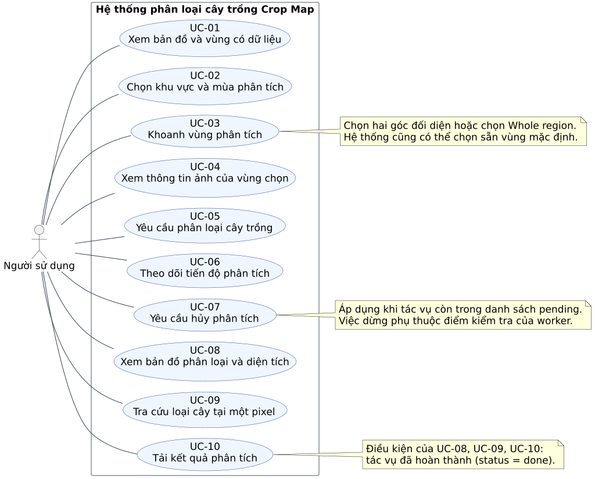

**Chú thích dùng trong báo cáo:** Các chức năng người sử dụng tương tác với hệ thống Crop Map, từ lựa chọn vùng và mùa đến theo dõi tác vụ, tra cứu pixel và tải kết quả phân loại.

**Thuyết minh:** Tác nhân chính là Người sử dụng. Tên ca sử dụng được đặt theo động từ và mục tiêu nghiệp vụ. Mô hình TSViT, worker và kho dữ liệu là thành phần bên trong hệ thống, không phải tác nhân ngoài. UC-08, UC-09 và UC-10 có điều kiện tác vụ đã hoàn thành; UC-07 chỉ có ý nghĩa khi tác vụ còn trong pending. Sơ đồ dùng quan hệ liên kết giữa tác nhân và chức năng; thứ tự thao tác được trình bày ở sơ đồ hoạt động và trình tự.

**Đối chiếu code:** [web/app.js:166](../../web/app.js#L166), [web/app.js:219](../../web/app.js#L219), [web/app.js:246](../../web/app.js#L246), [web/app.js:282](../../web/app.js#L282), [web/app.js:287](../../web/app.js#L287), [web/app.js:346](../../web/app.js#L346), [web/app.js:365](../../web/app.js#L365).

[SVG](hinh/svg/01-ca-su-dung.svg) · [PNG](hinh/png/01-ca-su-dung.png) · [PDF](hinh/pdf/01-ca-su-dung.pdf) · [Nguồn chỉnh sửa](nguon/01-ca-su-dung.puml)

### Hình 2. Kiến trúc tổng thể của hệ thống Crop Map

**Loại:** Sơ đồ thành phần và kết nối. **Vị trí đề xuất:** Thiết kế kiến trúc hệ thống.


**Chú thích dùng trong báo cáo:** Kiến trúc gồm trình duyệt, lớp API FastAPI, worker suy luận, bộ cung cấp ảnh đã chuẩn bị, bộ suy luận TSViT và các kho dữ liệu dạng file.

**Thuyết minh:** FastAPI phục vụ cả giao diện tĩnh và API. ThreadPoolExecutor tạo một luồng xử lý tác vụ trong cùng tiến trình Uvicorn; không có dịch vụ hàng đợi độc lập. Engine nạp checkpoint một lần khi khởi động rồi dùng lại đối tượng model cho các lượt suy luận mới. PreparedProvider đọc ảnh và metadata; PastisProvider chỉ là bí danh tương thích. Esri cung cấp ảnh nền cho trình duyệt, còn ảnh Sentinel-2 local mới là dữ liệu phân tích. Kết quả và trạng thái tác vụ được lưu thành file trong RESULTS/job_id.

**Đối chiếu code:** [app.py:54](../../app.py#L54), [app.py:216](../../app.py#L216), [app.py:305](../../app.py#L305), [app.py:433](../../app.py#L433), [inference.py:59](../../inference.py#L59), [inference.py:179](../../inference.py#L179), [inference.py:202](../../inference.py#L202), [inference.py:287](../../inference.py#L287), [web/app.js:16](../../web/app.js#L16).

[SVG](hinh/svg/02-kien-truc-he-thong.svg) · [PNG](hinh/png/02-kien-truc-he-thong.png) · [PDF](hinh/pdf/02-kien-truc-he-thong.pdf) · [Nguồn chỉnh sửa](nguon/02-kien-truc-he-thong.mmd)

### Hình 3. Sơ đồ hoạt động của chức năng phân tích vùng chọn

**Loại:** UML Activity Diagram có phân làn. **Vị trí đề xuất:** Thiết kế luồng xử lý.

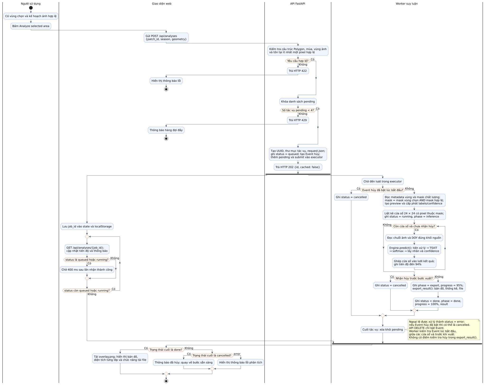

**Chú thích dùng trong báo cáo:** Hoạt động phân tích vùng chọn, gồm kiểm tra yêu cầu, giới hạn hàng đợi, thực thi suy luận, theo dõi tiến độ và xử lý trạng thái kết thúc.

**Thuyết minh:** Sơ đồ bắt đầu khi vùng chọn đã có kế hoạch ảnh hợp lệ. Sau khi API chấp nhận, nhánh frontend theo dõi tiến độ và nhánh worker xử lý dữ liệu diễn ra độc lập. Worker suy luận trên các cửa sổ có pixel hợp lệ, cập nhật tiến độ rồi xuất sản phẩm. Nhánh lỗi request và hàng đợi đầy kết thúc trước khi có tác vụ mới. Ngoại lệ runtime của worker được mô tả trong ghi chú và sơ đồ trạng thái. Việc chờ của nhánh frontend giả định kết nối API thành công; xử lý lỗi mạng được ghi trong phần quy tắc vận hành.

**Đối chiếu code:** [app.py:32](../../app.py#L32), [app.py:205](../../app.py#L205), [app.py:216](../../app.py#L216), [app.py:263](../../app.py#L263), [app.py:305](../../app.py#L305), [web/app.js:246](../../web/app.js#L246), [web/app.js:259](../../web/app.js#L259).

[SVG](hinh/svg/03-hoat-dong-phan-tich.svg) · [PNG](hinh/png/03-hoat-dong-phan-tich.png) · [PDF](hinh/pdf/03-hoat-dong-phan-tich.pdf) · [Nguồn chỉnh sửa](nguon/03-hoat-dong-phan-tich.puml)

### Hình 4. Sơ đồ trình tự tải danh mục và chuẩn bị vùng chọn

**Loại:** Sequence Diagram. **Vị trí đề xuất:** Thiết kế tương tác giữa các thành phần.

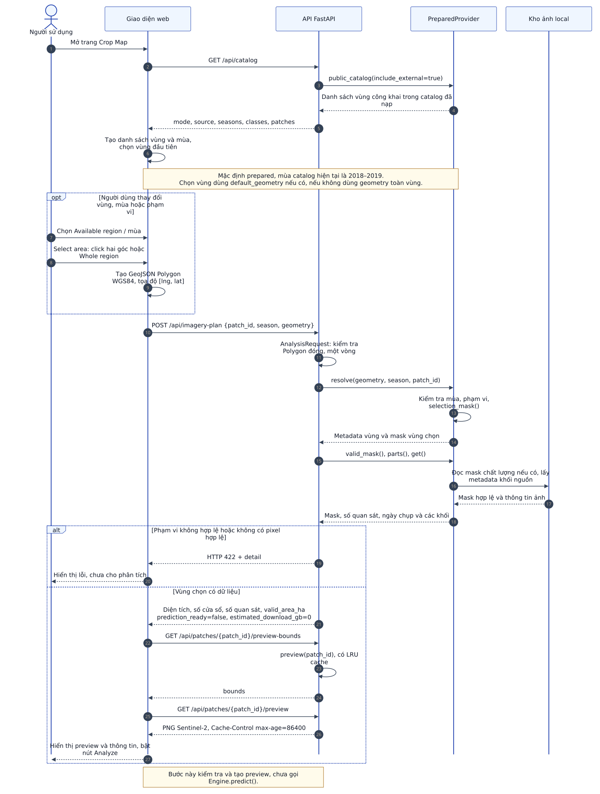

**Chú thích dùng trong báo cáo:** Tương tác khi tải danh mục, lựa chọn phạm vi, lập kế hoạch ảnh và hiển thị ảnh xem trước trước khi bắt đầu suy luận.

**Thuyết minh:** Frontend khởi tạo danh sách vùng và mùa từ /api/catalog. Sau khi lựa chọn geometry, /api/imagery-plan kiểm tra dữ liệu và trả thông tin diện tích, số cửa sổ, số quan sát và khả năng sử dụng ảnh. Các API preview-bounds và preview trả vị trí cùng PNG ảnh vệ tinh. Trong prepared, bước này không tải ảnh vệ tinh từ Internet và chưa gọi Engine.predict(). Nếu có kết quả từ bước plan cũ đến muộn, frontend dùng planToken để bỏ qua phản hồi không còn phù hợp.

**Đối chiếu code:** [app.py:110](../../app.py#L110), [app.py:130](../../app.py#L130), [app.py:165](../../app.py#L165), [inference.py:163](../../inference.py#L163), [inference.py:231](../../inference.py#L231), [inference.py:267](../../inference.py#L267), [web/app.js:104](../../web/app.js#L104), [web/app.js:365](../../web/app.js#L365).

[SVG](hinh/svg/04-trinh-tu-chuan-bi.svg) · [PNG](hinh/png/04-trinh-tu-chuan-bi.png) · [PDF](hinh/pdf/04-trinh-tu-chuan-bi.pdf) · [Nguồn chỉnh sửa](nguon/04-trinh-tu-chuan-bi.mmd)

### Hình 5. Sơ đồ trình tự thực hiện phân loại cây trồng

**Loại:** Sequence Diagram có nhánh song song. **Vị trí đề xuất:** Thiết kế tương tác giữa các thành phần.

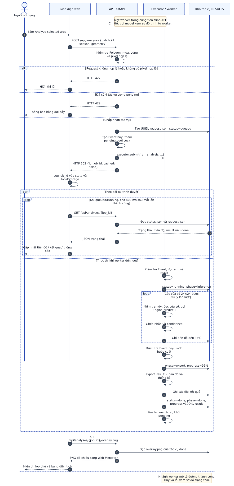

**Chú thích dùng trong báo cáo:** API trả mã tác vụ ngay sau khi tiếp nhận; frontend theo dõi trạng thái trong khi worker đọc ảnh, gọi TSViT và ghi các sản phẩm kết quả.

**Thuyết minh:** Phản hồi HTTP 202 chứa id và cached=false. Các lần GET trạng thái đọc file, tách khỏi công việc suy luận. Lời gọi executor.submit() là chuyển giao thực thi nền; Engine.predict() là lời gọi Python nội bộ. Nhánh par biểu diễn sự đồng thời giữa theo dõi trên trình duyệt và một worker xử lý; không biểu diễn nhiều cửa sổ được chạy đồng thời. Mỗi cửa sổ được xử lý lần lượt với batch=1. Nhánh worker trong hình thể hiện đường thành công; các trạng thái cancelled và error xem ở Hình 10.

**Đối chiếu code:** [app.py:71](../../app.py#L71), [app.py:216](../../app.py#L216), [app.py:269](../../app.py#L269), [app.py:305](../../app.py#L305), [app.py:358](../../app.py#L358), [inference.py:220](../../inference.py#L220), [web/app.js:246](../../web/app.js#L246), [web/app.js:259](../../web/app.js#L259), [web/app.js:287](../../web/app.js#L287).

[SVG](hinh/svg/05-trinh-tu-phan-tich.svg) · [PNG](hinh/png/05-trinh-tu-phan-tich.png) · [PDF](hinh/pdf/05-trinh-tu-phan-tich.pdf) · [Nguồn chỉnh sửa](nguon/05-trinh-tu-phan-tich.mmd)

### Hình 6. Sơ đồ trình tự suy luận trong worker

**Loại:** Sequence Diagram. **Vị trí đề xuất:** Thiết kế chi tiết lời gọi mô hình.

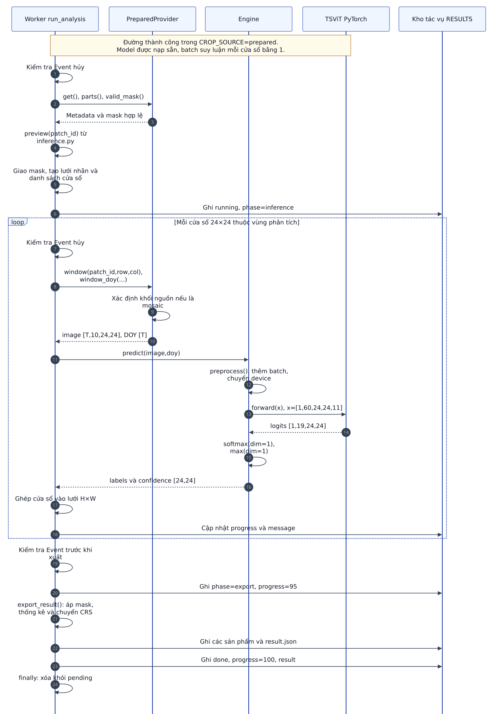

**Chú thích dùng trong báo cáo:** Worker ánh xạ cửa sổ về khối ảnh nguồn, gọi Engine và TSViT trong cùng tiến trình, ghép dự đoán rồi ghi các sản phẩm kết quả.

**Thuyết minh:** Sơ đồ bổ sung chi tiết cho sơ đồ điều phối tác vụ. PreparedProvider trả chuỗi ảnh theo frame_order và vector DOY tương ứng của khối nguồn. preview() là hàm hỗ trợ thuộc inference.py, không phải phương thức của PreparedProvider. Engine.predict() tạo batch một phần tử, tiền xử lý và chuyển dữ liệu tới device, rồi gọi đối tượng TSViT. TSViT chỉ trả logits; softmax và chọn lớp được thực hiện trong Engine.predict(). Worker nhận nhãn cùng confidence, ghép vào lưới và gọi export_result() sau khi hoàn tất các cửa sổ. Các lời gọi là nội bộ Python, không phải request HTTP tới dịch vụ model riêng.

**Đối chiếu code:** [app.py:216](../../app.py#L216), [app.py:269](../../app.py#L269), [inference.py:107](../../inference.py#L107), [inference.py:133](../../inference.py#L133), [inference.py:220](../../inference.py#L220), [inference.py:267](../../inference.py#L267), [model.py:129](../../model.py#L129).

[SVG](hinh/svg/05b-trinh-tu-worker.svg) · [PNG](hinh/png/05b-trinh-tu-worker.png) · [PDF](hinh/pdf/05b-trinh-tu-worker.pdf) · [Nguồn chỉnh sửa](nguon/05b-trinh-tu-worker.mmd)

### Hình 7. Sơ đồ trình tự tra cứu pixel và tải kết quả

**Loại:** Sequence Diagram. **Vị trí đề xuất:** Thiết kế chức năng khai thác kết quả.

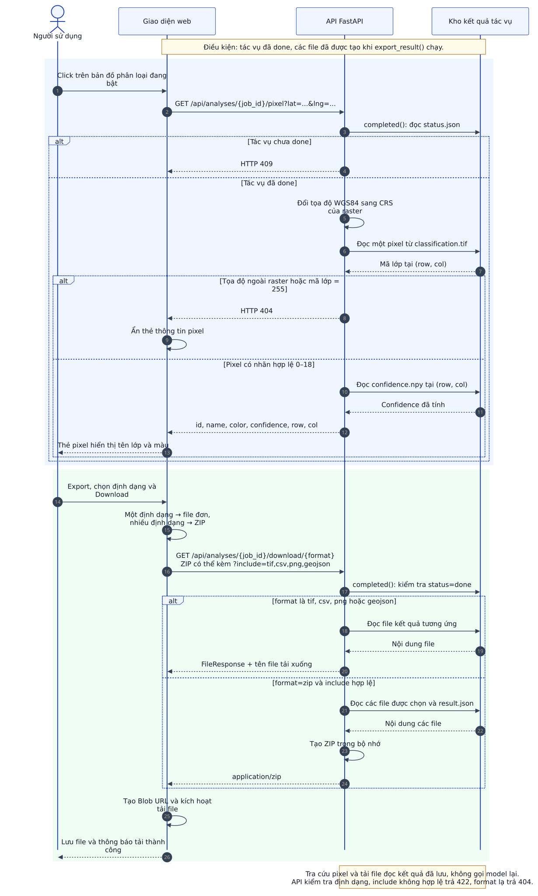

**Chú thích dùng trong báo cáo:** Tra cứu nhãn tại một tọa độ và tải các định dạng kết quả được thực hiện bằng cách đọc sản phẩm của tác vụ đã hoàn thành.

**Thuyết minh:** Backend chiếu lat/lng từ WGS84 sang CRS raster, xác định row/col, đọc mã lớp và confidence đã lưu. Mã 255 hoặc tọa độ ngoài raster trả 404; lớp 0 là Background hợp lệ. API trả confidence nhưng thẻ pixel hiện tại chỉ hiển thị tên và màu lớp. API download hỗ trợ tif, csv, png, geojson hoặc zip; ZIP chứa các định dạng được chọn và result.json. Trên giao diện, nút tải chọn file đơn khi có một định dạng và ZIP khi có nhiều định dạng. Các thao tác này không thực hiện thêm lượt model forward.

**Đối chiếu code:** [app.py:376](../../app.py#L376), [app.py:398](../../app.py#L398), [app.py:414](../../app.py#L414), [web/app.js:219](../../web/app.js#L219), [web/app.js:239](../../web/app.js#L239), [web/app.js:346](../../web/app.js#L346).

[SVG](hinh/svg/06-trinh-tu-tra-cuu-xuat.svg) · [PNG](hinh/png/06-trinh-tu-tra-cuu-xuat.png) · [PDF](hinh/pdf/06-trinh-tu-tra-cuu-xuat.pdf) · [Nguồn chỉnh sửa](nguon/06-trinh-tu-tra-cuu-xuat.mmd)

### Hình 8. Quy trình tiền xử lý, suy luận và tạo bản đồ phân loại

**Loại:** Sơ đồ pipeline dữ liệu. **Vị trí đề xuất:** Phương pháp xây dựng bản đồ phân loại.


**Chú thích dùng trong báo cáo:** Pipeline chuyển chuỗi ảnh Sentinel-2 thành tensor phù hợp checkpoint TSViT, dự đoán nhãn từng pixel và tạo sản phẩm theo vùng chọn có dữ liệu hợp lệ.

**Thuyết minh:** Chuỗi ảnh được đọc theo frame_order của từng khối nguồn; DOY đi kèm được provider chuẩn bị cùng thứ tự. Đầu vào tối đa 60 quan sát, 10 band phổ và một kênh thời gian. MEAN và STD cố định trong inference.py, không tính lại theo vùng người dùng chọn. Padding giữ zero ở cả 11 kênh; code không truyền attention mask riêng cho các bước padding. Toàn bộ cửa sổ 24×24 được đưa vào model; mask chỉ chọn cửa sổ và giới hạn pixel được công bố trong sản phẩm cuối. analysis_mask là tên mô tả trong sơ đồ; biến thực tế trong run_analysis() vẫn có tên mask sau phép giao.

**Đối chiếu code:** [imagery.py:35](../../imagery.py#L35), [inference.py:33](../../inference.py#L33), [inference.py:107](../../inference.py#L107), [inference.py:133](../../inference.py#L133), [inference.py:183](../../inference.py#L183), [inference.py:220](../../inference.py#L220), [inference.py:231](../../inference.py#L231), [inference.py:287](../../inference.py#L287), [app.py:237](../../app.py#L237).

[SVG](hinh/svg/07-pipeline-suy-luan.svg) · [PNG](hinh/png/07-pipeline-suy-luan.png) · [PDF](hinh/pdf/07-pipeline-suy-luan.pdf) · [Nguồn chỉnh sửa](nguon/07-pipeline-suy-luan.mmd)

### Hình 9. Kiến trúc TSViT và kích thước tensor trong quá trình suy luận

**Loại:** Sơ đồ kiến trúc mô hình. **Vị trí đề xuất:** Mô hình phân loại theo thời gian và không gian.


**Chú thích dùng trong báo cáo:** TSViT mã hóa patch ảnh và ngày quan sát, xử lý bằng Temporal Transformer rồi Spatial Transformer, cuối cùng sinh logits cho 19 lớp tại mỗi pixel.

**Thuyết minh:** Cửa sổ đầu vào 24×24 được chia thành 144 patch kích thước 2×2. Một patch phổ có 40 giá trị rồi được ánh xạ sang vector 128 chiều. DOY được chuyển thành one-hot 366 chiều, gồm giá trị 0 của padding, và qua Linear thành embedding thời gian. Sau khi ghép 19 token lớp, Temporal Transformer xử lý chuỗi 79 token; chỉ 19 token lớp được giữ. Spatial Transformer xử lý 144 vị trí cho từng lớp. Mỗi đầu ra patch sinh 4 điểm số để dựng lưới logits [B,19,24,24]. Temporal và Spatial Transformer đều có 4 tầng và 4 heads theo config hiện tại.

**Đối chiếu code:** [model.py:89](../../model.py#L89), [model.py:113](../../model.py#L113), [model.py:129](../../model.py#L129), [inference.py:183](../../inference.py#L183), [inference.py:220](../../inference.py#L220), [weights/config.yaml:36](../../weights/config.yaml#L36).

[SVG](hinh/svg/08-kien-truc-tsvit.svg) · [PNG](hinh/png/08-kien-truc-tsvit.png) · [PDF](hinh/pdf/08-kien-truc-tsvit.pdf) · [Nguồn chỉnh sửa](nguon/08-kien-truc-tsvit.mmd)

### Hình 10. Sơ đồ trạng thái của tác vụ phân tích

**Loại:** State Diagram. **Vị trí đề xuất:** Thiết kế quản lý tác vụ.


**Chú thích dùng trong báo cáo:** Vòng đời một tác vụ phân tích với các trạng thái queued, running, done, cancelled và error, cùng các sự kiện hủy hoặc khởi động lại máy chủ.

**Thuyết minh:** status biểu diễn vòng đời; phase mô tả bước đang thực hiện. Trong prepared, worker ghi phase=inference, export rồi done; không có status tên export hay status tên cancelling. DELETE chỉ bật Event, không xóa thư mục và không đổi trạng thái ngay. Worker nhận yêu cầu hủy tại điểm kiểm tra, bao gồm trước từng cửa sổ và trước khi xuất. Nếu gửi hủy trong export_result(), tác vụ có thể vẫn hoàn thành done. Khi server khởi động lại, status.json còn queued/running bị chuyển error; file done được giữ. Lần Analyze mới tạo job mới, dù đã có cache_key hay PredictionStore trong mã.

**Đối chiếu code:** [app.py:54](../../app.py#L54), [app.py:216](../../app.py#L216), [app.py:263](../../app.py#L263), [app.py:274](../../app.py#L274), [app.py:287](../../app.py#L287), [app.py:342](../../app.py#L342), [app.py:366](../../app.py#L366).

[SVG](hinh/svg/09-trang-thai-tac-vu.svg) · [PNG](hinh/png/09-trang-thai-tac-vu.png) · [PDF](hinh/pdf/09-trang-thai-tac-vu.pdf) · [Nguồn chỉnh sửa](nguon/09-trang-thai-tac-vu.mmd)

### Hình 11. Mô hình triển khai hệ thống bằng Docker Compose

**Loại:** Sơ đồ triển khai vật lý. **Vị trí đề xuất:** Triển khai và vận hành hệ thống.


**Chú thích dùng trong báo cáo:** Cấu hình triển khai Docker Compose với một container ứng dụng, một tiến trình Uvicorn, các thư mục ảnh và trọng số chỉ đọc, cùng volume lưu kết quả có quyền ghi.

**Thuyết minh:** Sơ đồ bám theo compose.yaml và Dockerfile, không khẳng định ứng dụng đã được triển khai lên EC2. Cổng host mặc định chỉ bind 127.0.0.1:8000; cấu hình khác do CROP_BIND và CROP_PORT quyết định. Checkpoint và dữ liệu mount read-only; results là named volume. Container đặt giới hạn cpus=2 và mem_limit=2g, chạy với user cropmap. Docker healthcheck gọi /api/health để kiểm tra ứng dụng trả lời, không đo chất lượng dự đoán. Esri là kết nối từ trình duyệt ra dịch vụ ngoài.

**Đối chiếu code:** [compose.yaml:1](../../compose.yaml#L1), [compose.yaml:15](../../compose.yaml#L15), [compose.yaml:29](../../compose.yaml#L29), [Dockerfile:14](../../Dockerfile#L14), [Dockerfile:28](../../Dockerfile#L28), [app.py:94](../../app.py#L94).

[SVG](hinh/svg/10-trien-khai-docker.svg) · [PNG](hinh/png/10-trien-khai-docker.png) · [PDF](hinh/pdf/10-trien-khai-docker.pdf) · [Nguồn chỉnh sửa](nguon/10-trien-khai-docker.mmd)

### Hình 12. Quy trình bổ sung ảnh từ THEIA/GEODES ở chế độ tùy chọn

**Loại:** Lưu đồ nhánh nguồn dữ liệu. **Vị trí đề xuất:** Phụ lục hoặc cơ chế nguồn ảnh bổ sung.


**Chú thích dùng trong báo cáo:** Nhánh CROP_SOURCE=geodes tìm và chuẩn bị ảnh Sentinel-2 theo vùng và mùa, sau đó sử dụng chung bộ suy luận và xuất kết quả với luồng prepared.

**Thuyết minh:** Nhánh này dùng GeodesProvider và khóa GEODES_API_KEY. Plan lựa chọn tile phủ đủ vùng, sản phẩm ZIP online và tối đa 60 acquisition phân bố đều nếu có nhiều hơn. Prepare tái sử dụng cache ảnh căn chỉnh hoặc tải ZIP toàn cảnh. Acquisition phải có ít nhất 50% vùng chọn clear; pixel được phân loại phải nằm trong selected, có dữ liệu native ở mọi acquisition được giữ và có ít nhất 3 quan sát clear. DOY dùng lịch không nhuận trước khi sắp xếp. Các lỗi và giới hạn chi tiết xem mã imagery.py; sơ đồ tập trung vào đường chuẩn bị dữ liệu chính, không mô tả giao thức quota/retry ở lớp Download.

**Đối chiếu code:** [imagery.py:66](../../imagery.py#L66), [imagery.py:76](../../imagery.py#L76), [imagery.py:290](../../imagery.py#L290), [imagery.py:319](../../imagery.py#L319), [imagery.py:377](../../imagery.py#L377), [imagery.py:425](../../imagery.py#L425), [app.py:227](../../app.py#L227).

[SVG](hinh/svg/11-nhanh-nguon-anh-geodes.svg) · [PNG](hinh/png/11-nhanh-nguon-anh-geodes.png) · [PDF](hinh/pdf/11-nhanh-nguon-anh-geodes.pdf) · [Nguồn chỉnh sửa](nguon/11-nhanh-nguon-anh-geodes.mmd)

## Đối chiếu API

| Method | Endpoint | Chức năng | HTTP status chính |
| --- | --- | --- | --- |
| GET | /api/catalog | Danh mục vùng, mùa, lớp và nguồn ảnh. | 200 |
| POST | /api/imagery-plan | Kiểm tra phạm vi và thông tin ảnh; chưa suy luận. | 200; 422 khi dữ liệu không hợp lệ |
| GET | /api/patches/{patch_id}/preview-bounds | Vị trí địa lý của ảnh xem trước. | 200; 404 khi vùng không có |
| GET | /api/patches/{patch_id}/preview | PNG ảnh Sentinel-2 xem trước. | 200; 404 khi vùng không có |
| POST | /api/analyses | Tạo tác vụ mới, trả {id, cached:false}. | 202; 422 request; 429 hàng đợi đầy |
| GET | /api/analyses/{job_id} | Đọc status/progress/message, request và result nếu done. | 200; 404 nếu job_id không tồn tại |
| DELETE | /api/analyses/{job_id} | Yêu cầu hủy bằng Event; trả cancellation_requested. | 200; 404 nếu job_id không tồn tại |
| GET | /api/analyses/{job_id}/overlay.png | Lớp phủ phân loại của tác vụ done. | 200; 404 job; 409 chưa done |
| GET | /api/analyses/{job_id}/preview.png | Ảnh vệ tinh xem trước của tác vụ done. | 200; 404 job/ảnh; 409 chưa done |
| GET | /api/analyses/{job_id}/pixel?lat=...&lng=... | Đọc nhãn và confidence tại tọa độ. | 200; 404 job/pixel; 409 chưa done; 422 tọa độ |
| GET | /api/analyses/{job_id}/download/{format} | File tif/csv/png/geojson hoặc ZIP kèm result.json. | 200; 404 job/format; 409 chưa done; 422 include |
| GET | /api/health | Thông tin model, device, checkpoint và nguồn ảnh. | 200 khi ứng dụng sẵn sàng |

Các mã lỗi trong bảng là những nhánh chính của luồng mô tả; lỗi hạ tầng hoặc file không tồn tại có thể phát sinh thêm. Mã 422 cũng do FastAPI/Pydantic tạo khi cấu trúc request không hợp lệ.

## Danh mục 19 lớp đầu ra

Tên tiếng Anh là giá trị nguyên gốc trong CLASS_NAMES và được trả qua API. Tên tiếng Việt dưới đây là cách gọi đề xuất trong phần thuyết minh; không thay đổi dữ liệu hoặc nhãn model.

| Mã lớp | Tên nguyên gốc trong code | Tên tiếng Việt đề xuất |
| --- | --- | --- |
| 0 | Background | Nền |
| 1 | Meadow | Đồng cỏ |
| 2 | Soft winter wheat | Lúa mì mềm vụ đông |
| 3 | Corn | Ngô |
| 4 | Winter barley | Đại mạch vụ đông |
| 5 | Winter rapeseed | Cải dầu vụ đông |
| 6 | Spring barley | Đại mạch vụ xuân |
| 7 | Sunflower | Hướng dương |
| 8 | Grapevine | Nho |
| 9 | Beet | Củ cải đường |
| 10 | Winter triticale | Triticale vụ đông |
| 11 | Winter durum wheat | Lúa mì cứng vụ đông |
| 12 | Fruits, vegetables, flowers | Trái cây, rau và hoa |
| 13 | Potatoes | Khoai tây |
| 14 | Leguminous fodder | Cây họ đậu làm thức ăn chăn nuôi |
| 15 | Soybeans | Đậu tương |
| 16 | Orchard | Vườn cây ăn quả |
| 17 | Mixed cereal | Ngũ cốc hỗn hợp |
| 18 | Sorghum | Cao lương |

## Những quy tắc cần giữ khi diễn giải

1. Bộ sơ đồ chính mô tả inference bằng checkpoint có sẵn, không mô tả một quy trình huấn luyện online trên web.
2. Mỗi lần Analyze được chấp nhận tạo job mới và thực hiện model forward mới. cache_key/completed/PredictionStore vẫn xuất hiện trong code nhưng luồng tương tác đặt cached=None và reused_prediction=False.
3. Giới hạn 4 áp dụng cho tổng số tác vụ trong pending, gồm chờ và chạy; không phải 4 worker suy luận. API HTTP vẫn có thể phục vụ request khác khi worker đang chạy.
4. Kho dữ liệu được mô tả bằng file JSON, NPY, GeoTIFF và các sản phẩm xuất; bản hiện tại không cài một cơ sở dữ liệu quan hệ cho tác vụ phân tích.
5. Frontend kiểm tra plan trước khi bật Analyze. POST /api/analyses vẫn tự kiểm tra lại request, vùng dữ liệu và mask; frontend không gửi một plan_id bắt buộc.
6. Số cửa sổ trong imagery-plan tính theo mask vùng chọn, còn vòng inference dùng mask sau giao với valid_mask. Vì vậy số cửa sổ dự báo có thể lớn hơn số cửa sổ thực sự chạy.
7. Trong prepared, tiến độ vòng cửa sổ tăng đến 94%, export bắt đầu ở 95%, hoàn tất là 100%. Đây là tiến độ tác vụ, không phải phần trăm độ chính xác hoặc cam kết thời gian còn lại.
8. DELETE không xóa tác vụ hoặc sản phẩm. cancellation_requested=true nghĩa đã bật Event của tác vụ còn trong pending; cần đọc status tiếp để biết đã cancelled hay vẫn done.
9. Dừng không ngắt tức thời một lần TSViT.forward() hoặc export_result(). Trong giai đoạn xuất, yêu cầu hủy đến muộn có thể không ngăn tác vụ hoàn tất.
10. Worker cập nhật status.json theo ghi file tạm rồi replace, giúp frontend tránh đọc JSON đang ghi dở. Trạng thái running có thể chỉ được ghi sau khi chuẩn bị preview; lỗi sớm có thể chuyển file từ queued thẳng sang error.
11. Nếu GET trạng thái lỗi, frontend thử lại sau 1.500 ms và báo lỗi ở lần lỗi liên tiếp thứ ba. Lỗi kết nối của frontend không tự hủy job đang chạy trên server.
12. localStorage lưu job_id gần nhất để nối lại theo dõi tác vụ queued/running khi tải lại trang. boot() hiện tại không tự render lại kết quả done; không nên mô tả là khôi phục đầy đủ mọi kết quả sau refresh.
13. Ảnh Sentinel-2 RGB xem trước chỉ biểu diễn một ngày; model dùng chuỗi 10 band: B2, B3, B4, B5, B6, B7, B8, B8A, B11, B12.
14. 19 lớp gồm Background=0 và 18 lớp còn lại. Mã void=19 của một số bộ nhãn đánh giá không phải đầu ra của checkpoint này; nodata trong sản phẩm web là 255.
15. Thống kê dùng số pixel có tâm thuộc vùng chọn và có dữ liệu hợp lệ. Diện tích mỗi pixel là 0,01 ha; area_ha của kết quả có thể nhỏ hơn selected_area_ha nếu loại pixel thiếu dữ liệu.
16. GeoTIFF và classification.png dùng lưới ảnh native; GeoJSON xuất WGS84; overlay.png được chiếu Web Mercator trước khi Leaflet hiển thị.
17. Endpoint /api/patches/{patch_id}/tiles/... và /api/patches/{patch_id}/pixel hiện trả 404 theo chủ ý. Lớp phân loại tương tác đến từ một analysis đã done, không phải prediction tile có sẵn.
18. Bản Docker mặc định bind localhost và dùng CPU. Việc mở truy cập ngoài hoặc triển khai EC2 cần cấu hình tương ứng; sơ đồ triển khai không khẳng định hạ tầng đó đã tồn tại.
19. Không thêm biểu đồ mIoU, F1, confusion matrix hoặc thời gian xử lý giả định vào báo cáo. Các hình thực nghiệm cần được tạo từ kết quả đo và tập nhãn đối chiếu thật.

## Xuất lại tài liệu

Công cụ tạo hình được cài riêng với ứng dụng. Script không chạy inference hoặc chỉnh sửa source của web.

```bash
PUPPETEER_SKIP_DOWNLOAD=true npm install --prefix /tmp/crop-map-report-tools @mermaid-js/mermaid-cli
# Đặt plantuml.jar trong /tmp/crop-map-report-tools/; bộ hiện tại dùng PlantUML 1.2025.10.
python3 -m pip install --target /tmp/crop-map-report-tools/python python-docx pypdf
node docs/bao-cao/xuat-hinh.mjs
PYTHONPATH=/tmp/crop-map-report-tools/python python3 docs/bao-cao/dong-goi.py
```

Có thể đặt REPORT_TOOLS_DIR và REPORT_CHROME khi thay đổi đường dẫn công cụ. Nếu Chrome nằm ở vị trí khác, cập nhật cả nguon/puppeteer-config.json dùng bởi Mermaid CLI. Tệp kiem-chung.json ghi hash các file nguồn được đối chiếu và kiểm tra sản phẩm xuất. Các tệp trong gói ZIP không chứa ảnh vệ tinh đầu vào, checkpoint hay thông tin khóa truy cập.
